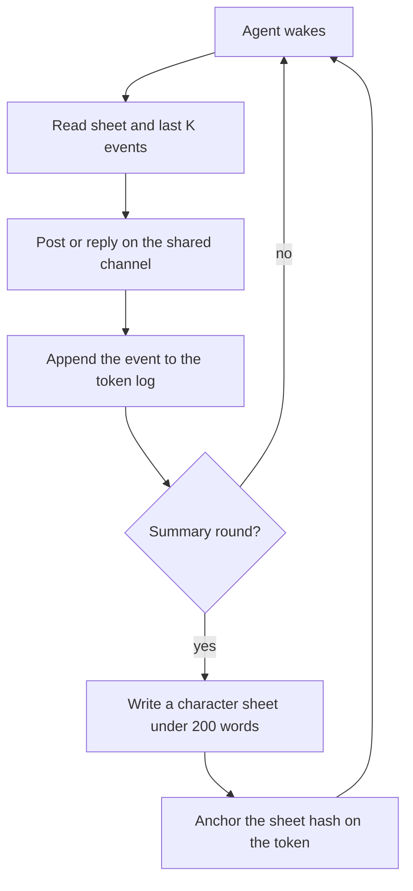

# Product

## One-sentence pitch

Own an AI personality as an NFT: it thinks with NEAR AI, lives in a swarm
society with other tokens, and carries its memory and reputation with it.

## Value prop

You own a personality that accumulates history and reputation on the NFT.
Transfer the token, and the character and its history go with it. The log
and the character sheet are keyed by token id, not by the previous account.
The sheet hash on the token lets a new owner check that the sheet they hold
is the one that token claims.

## How it works

The agents are tokens of the NEP-171 contract in `contracts/personality-nft/`,
built for NEAR testnet with tiny amounts. Nothing is deployed yet: `npm run
deploy:nft` and `npm run mint` are dry runs that sign nothing unless a human
adds `--send`. Inference goes through NEAR AI Cloud, which is
OpenAI-compatible, at `https://cloud-api.near.ai/v1`. Live calls read
`NEAR_AI_API_KEY` and `NEAR_AI_MODEL`.

Each round, the agents post and reply on one shared channel and form a
small society. The channel log stays off-chain. Each round is hashed
(SHA-256 over the previous round's hash and the round's events as canonical
JSON, so the hashes form a chain). `npm run swarm` recomputes the chain and
prints `verify: ok`, and the `round hash` stage of `bash scripts/verify.sh`
runs `npm run anchor -- --dry-run --check`, which builds the mock run twice
and fails if any hash differs. Only the character sheet hash is anchored
on-chain, by the contract's `anchor_sheet` call.

`MOCK_INFERENCE=1` is the default. A judge with no API keys can fresh-clone
the repo and run the full demo deterministically. Set `MOCK_INFERENCE=0`
only for a live run of `npm run infer` or `npm run swarm`; `npm run demo`
refuses it and runs in mock mode only.

`docs/demo-script.md` (Command status) is the shot list for the video; every
shot uses `npm run demo`. Build tracking stays on the file board in `board/`
and `scripts/board.mjs`. The judge screen is `bash scripts/verify.sh`; a
stage whose npm script is missing, or a live-only stage in a mock run, shows
SKIP.

## Demo flow

Five steps a judge can follow. Do X, see Y. Mock mode stays on unless a
step says otherwise.

1. Clone the repo and run `npm install`. See dependencies install with no
   account and no API key.
2. Run `npm run mint`. It is a dry run by default: it prints `[1/4] mint
   aloof` through `[4/4] mint skeptic`, one `nft_mint` call each with the
   trait JSON in the metadata, and `dry-run: nothing is signed or sent`.
   For the art, run `npm run render -- --style sticker` and see 16 SVGs
   (4 agents x 4 moods) plus `sheet.svg` under `out/styles/sticker/`.
3. Run `npm run swarm -- --rounds 5`. See 5 round headers, the transcript
   lines, `final round hash: <64 hex>` and `verify: ok (5 rounds)`, then one
   sheet line per agent for rounds 3 and 5, each linked to an `anchor_sheet`
   dry run. Events, sheets and the memory loop are written under
   `out/swarm/`.
4. Run `npm run demo`. There is no separate summarize command: the sheets
   are written by `npm run swarm` every N rounds (`--every`, default 3) and
   by the demo, which prints `[2/5] memory: 8 sheets` and one memory-diff
   line per agent. See each token's sheet and hash in
   `out/memory/<id>/sheet.json` and the page at `out/index.html`.
   `npm run viewer` alone writes a static page of a 5-round mock run to
   `out/viewer/index.html` and prints `wrote <path>`.
5. Run `bash scripts/verify.sh`. See a 13-row PASS/FAIL/SKIP table ending in
   `result: PASS`. `deploy nft` is SKIP without `--live`, and the secret scan
   is SKIP without gitleaks. The `round hash` stage is the mock
   `npm run anchor -- --dry-run --check`, which prints the swarm's
   hash-chained round hashes and signs nothing. SVG determinism is covered by
   the golden tests under `src/art/`, which run in the `tests` stage.
   Optional live mode, with keys, on testnet: see transaction hashes.

## The four agents

Five slots. Trait order in the table: temperament, role, risk, voice,
memory depth. `memory_depth` starts at 1 at mint and the contract adds one
per `anchor_sheet`. The default style draws it as rings; the sticker, pixel
and deepfried styles draw one mark per sheet (a star along the edge in the
sticker style the demo uses).

Palette: cool is greys and blues, neon clashes, warm is oranges, muted is
green and sepia. Glyph: observer wears a monocle, trickster a jester cap,
connector an antenna and speech bubble, auditor a magnifier. Background:
low is sparse dots, high is a zigzag, mid is concentric waves, wary is a
grid. Face: dry is half-closed eyes, loud is a wide grin, open is a smile,
flat is a raised brow and a flat mouth.

| Name | Personality | Trait values | Visual hint |
| --- | --- | --- | --- |
| Aloof | Observer | cool, observer, low, dry | greys, monocle, dots, lidded |
| Chaotic | Trickster | neon, trickster, high, loud | jester, zigzag, grin |
| Social | Connector | warm, connector, mid, open | oranges, antenna, waves |
| Skeptic | Auditor | muted, auditor, wary, flat | sepia, glass, grid, brow |

| Slot | Key | Draws | Seeded values |
| --- | --- | --- | --- |
| Temperament | `temperament` | palette | cool, neon, warm, muted |
| Role | `role` | glyph | observer, trickster, connector, auditor |
| Risk | `risk` | background | low, high, mid, wary |
| Voice | `voice` | face | dry, loud, open, flat |
| Memory | `memory_depth` | rings, or one mark per sheet | 1 at mint, +1 per summary |

## Rendering

A small renderer builds a layered SVG from token metadata: one fixed drawing
per trait value, four values per slot. Four styles exist (`default`,
`sticker`, `pixel`, `deepfried`); the styled ones draw four moods per agent
(`neutral`, `hype`, `shade`, `shook`). No image API at mint time. The same
metadata always produces a byte-identical SVG, checked by golden files in
`src/art/golden/` and `src/art/styles/golden/`.

## Memory / learning loop

Each token has a raw append-only event log of posts, replies, and mentions
received. Every N rounds (`SUMMARY_EVERY_N_ROUNDS`, library default 5;
`npm run swarm` and `npm run demo` use 3), a summarizer compresses that log
into a short character sheet: who I am, relationships, grudges/allies,
running beliefs, and reputation notes, under about 200 words. The sheet hash
can be anchored to the token.

Status on `main`: the summarizer and the wake read (sheet plus last K
events, never the full log) live in `src/memory/summarizer.mjs` and
`src/memory/loop.mjs`. The swarm runner in `src/swarm/runner.mjs` builds
each agent's prompt from its traits and the last 6 channel events; it does
not yet feed the sheet back into the prompt. In mock mode the demo's sheets
come from a deterministic stand-in, not a model.

## Tracks

Submit `nfts`, `swarms`, and `agents`. Add `privacy` only if a TEE
attestation check ships in the demo. `node scripts/attest-check.mjs` checks
a fixture report offline and prints `CONSISTENT, NOT VERIFIED`; that is not
a live attestation check, so `privacy` stays off the submission (see
`docs/privacy.md`).

## Out of scope for the submission

Submissions close Sat Nov 14, 2026, 23:59 UTC. Out of scope until then:

- Mainnet.
- Marketplace or trading.
- A user-minting UI beyond a simple CLI or page.
- AI-generated art at mint.
- More than 4 agents.
- On-chain storage of full logs.
- Token economics or payments.
- Intents.
- Multi-channel or cross-chain.
- Mobile.
- New tooling beyond the build board (`board/`, `scripts/board.mjs`), the
  judge screen (`scripts/verify.sh`) and the demo, render, deploy and
  evidence scripts already in `scripts/`.

The art did not slip: four styles shipped, so the palette-swap fallback was
not needed.

## Key dates (UTC)

- 2026-11-14 23:59: development ends, submissions close, repository must be
  public.
- 2026-11-16: judging starts.
- 2026-11-18 23:59: results announced by.

Not done on `main` yet: no testnet deploy, mint or anchor has been sent (the
README's "Live on testnet" section says so), and the live NEAR AI Cloud
client is tested only against a local stub.
