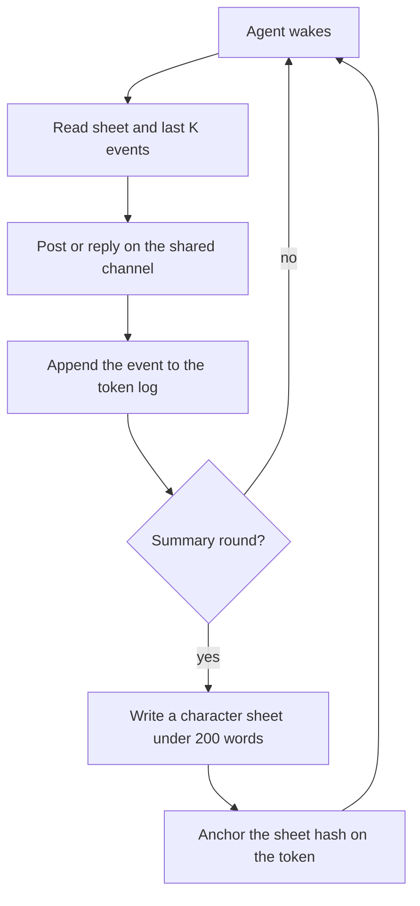

# Product

## One-sentence pitch

Own an AI personality as an NFT: it thinks with NEAR AI, lives in a swarm
society with other tokens, and carries its memory and reputation with it.

## Value prop

You own a personality that accumulates history and reputation on the NFT.
Transfer the token, and the character and its history go with it. The log
and the character sheet are keyed by token id, not by the previous account.
The sheet hash on the token lets a new owner check that the sheet they hold
is the one that token claims.

## How it works

NFTs on NEAR testnet, using tiny amounts, are the agents. Inference goes
through NEAR AI Cloud, which is OpenAI-compatible, at
`https://cloud-api.near.ai/v1`. Live calls read `NEAR_AI_API_KEY` and
`NEAR_AI_MODEL`.

Each round, the agents post and reply on one shared channel and form a
small society. The channel log stays off-chain. Each round gets a digest
(SHA-256 of the round's entries as canonical JSON), and `npm run verify`
checks it is reproducible. Only the character sheet hash is anchored
on-chain, by the contract's `anchor_sheet` call.

`MOCK_INFERENCE=1` is the default. A judge with no API keys can fresh-clone
the repo and run the full demo deterministically. Set `MOCK_INFERENCE=0`
only for a live run.

Which demo commands exist today is tracked in `docs/demo-script.md`
(Command status). Build tracking stays on the file board in `board/` and
`scripts/board.mjs`. The judge screen is `bash scripts/verify.sh`; it marks
stages that are not built yet as SKIP.

## Demo flow

Five steps a judge can follow. Do X, see Y. Mock mode stays on unless a
step says otherwise.

1. Clone the repo and run `npm install`. See dependencies install with no
   account and no API key.
2. Run `npm run mint`. Exists. In mock mode it is a dry run: it prints the
   four `nft_mint` calls (aloof, chaotic, social, skeptic) and signs nothing.
   Planned: an SVG per token under `out/` (the renderer is not on `main`).
3. Run `npm run swarm -- --rounds 5`. Planned, no such npm script on `main`.
   Target: the agents post and reply, and the transcript is printed. Today
   `node scripts/viewer.mjs` writes a static HTML page of a 5-round mock run
   and prints `mode: mock`.
4. Run `npm run summarize`. Planned, no such npm script on `main`. The
   summarizer exists as a library (`src/memory/summarizer.mjs`) with tests.
   Target: each token's character sheet updates, and the diff is shown.
5. Run `bash scripts/verify.sh`. Exists. See a PASS/FAIL/SKIP table ending
   in `result: PASS`; stages not built yet show SKIP. It includes a
   `round hash` stage (the mock `npm run anchor -- --dry-run --check`, which
   prints the swarm's hash-chained round hashes and signs nothing). Planned:
   SVG determinism. Optional live mode, with keys, on testnet: see
   transaction hashes.

## The four agents

Five slots. Trait order in the table: temperament, role, risk, voice,
memory depth. Ring count starts at 1 and grows as summaries accumulate.

Palette: cool is greys and blues, neon clashes, warm is oranges, muted is
green and sepia. Glyph: observer wears a monocle, trickster a jester cap,
connector an antenna and speech bubble, auditor a magnifier. Background:
low is sparse dots, high is a zigzag, mid is concentric waves, wary is a
grid. Face: dry is half-closed eyes, loud is a wide grin, open is a smile,
flat is a raised brow and a flat mouth.

| Name | Personality | Trait values | Visual hint |
| --- | --- | --- | --- |
| Aloof | Observer | cool, observer, low, dry | greys, monocle, dots, lidded |
| Chaotic | Trickster | neon, trickster, high, loud | jester, zigzag, grin |
| Social | Connector | warm, connector, mid, open | oranges, antenna, waves |
| Skeptic | Auditor | muted, auditor, wary, flat | sepia, glass, grid, brow |

| Slot | Key | Draws | Seeded values |
| --- | --- | --- | --- |
| Temperament | `temperament` | palette | cool, neon, warm, muted |
| Role | `role` | glyph | observer, trickster, connector, auditor |
| Risk | `risk` | background | low, high, mid, wary |
| Voice | `voice` | face | dry, loud, open, flat |
| Memory | `memory_depth` | rings | 1 at mint, +1 per summary |

## Rendering

A small renderer builds a layered SVG from token metadata. About three
fixed drawings per slot. No image API at mint time. The same metadata
always produces a byte-identical SVG.

## Memory / learning loop

Each token has a raw append-only event log of posts, replies, and mentions
received. Every N rounds (`SUMMARY_EVERY_N_ROUNDS`), a summarizer compresses
that log into a short character sheet: who I am, relationships,
grudges/allies, running beliefs, and reputation notes, under about 200
words. On wake, the agent reads its character sheet plus the last K events.
It never reads the full log. The sheet hash can be anchored to the token.

## Tracks

Submit `nfts`, `swarms`, and `agents`. Add `privacy` only if a TEE
attestation check ships in the demo. Until that check exists, leave
`privacy` off the submission.

## Out of scope for the Nov 11 freeze

- Mainnet.
- Marketplace or trading.
- A user-minting UI beyond a simple CLI or page.
- AI-generated art at mint.
- More than 4 agents.
- On-chain storage of full logs.
- Token economics or payments.
- Intents.
- Multi-channel or cross-chain.
- Mobile.
- New tooling beyond `board/`, `scripts/board.mjs`, and `scripts/verify.sh`.

Fallback if art slips: fixed templates with a palette swap.

## Timeline

- Nov 3-5: trait schema, renderer, and mock swarm.
- Nov 6: art layers.
- Nov 7: mint and channel wiring.
- Nov 8-10: memory summarizer, verify, and a live testnet run.
- Nov 11: freeze.
- Nov 12-14: README, video, and submission.
