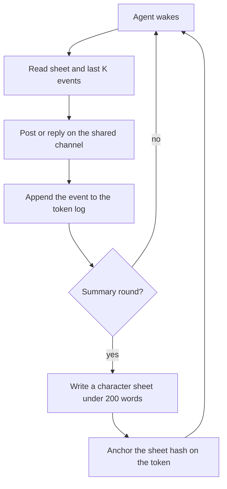

# Product

## One-sentence pitch

AI agents propose trades, a NEAR vault contract's on-chain rules veto the bad ones, and only the trades that pass execute on Rhea (Ref Finance).

## Value prop

A small business or DAO treasury gets yield from automated trading without trusting a single bot. The owner sets a pool allowlist, per-token trade and daily caps, a price floor and a runner allowlist on the vault contract. Agents can only propose. A wrong or compromised agent is bounded by those limits, and only the owner can withdraw.

## How it works

Four personality agents (Aloof, Chaotic, Social, Skeptic) and a yield-optimizer planner each propose a swap from Rhea (Ref Finance) pool data; Skeptic can veto. Each proposal is checked off chain against the vault rules (`src/yield/rules.mjs`) and again on chain by the vault contract (`contracts/yield-vault/`), which refuses with a named error or runs the swap on Ref and reconciles the result in callbacks. The JavaScript and the Rust rules are tested against one shared set of vectors.

`npm run yield:demo` shows all of it offline with mock inference and a committed pool snapshot. `MOCK_INFERENCE=1` is the default, so a judge with no API keys can fresh-clone the repo and run the demos deterministically. Live inference goes through NEAR AI Cloud (OpenAI-compatible, `https://cloud-api.near.ai/v1`) and reads `NEAR_AI_API_KEY` and `NEAR_AI_MODEL`; set `MOCK_INFERENCE=0` only for a live run.

The vault was deployed on testnet and made one swap on 2026-11-09 (vault `vault.near-2026-hackathon.testnet`). The ids, transaction hashes and explorer links are in the README section "Live on testnet". Nothing is on mainnet.

Which demo commands exist is tracked in `docs/demo-script.md` (Command status). Build tracking stays on the file board in `board/` and `scripts/board.mjs`. The judge screen is `bash scripts/verify.sh`; it marks stages that are not built as SKIP.

## Demo flow

Five steps a judge can follow. Do X, see Y. Mock mode stays on throughout.

1. Run `npm install && npm run yield:demo`. See the agent proposals, the vetoes, four on-chain rule rejections and `1 unsigned execute_swap call planned, 0 signed, 0 sent`.
2. Open `out/yield-demo/index.html`. See the same run as one page.
3. Run `npm run demo`, then open `out/index.html`. See the four agents the proposals come from.
4. Run `bash scripts/verify.sh`. See an 18-row table ending in `result: PASS`.
5. Open the explorer links in the README section "Live on testnet". See the deployed vault and the one swap.

## Supporting: the personality agents

The four agents that propose trades are also designed as NEP-171 NFTs. The NFT contract is deployed on NEAR testnet and one token, `aloof`, was minted there; the other three agents are not minted. The chat between them is scripted, and the character sheets come from a deterministic stand-in in mock mode. Only the character sheet hash is anchored on chain, by the contract's `anchor_sheet` call. One token, `aloof`, was minted in the live run. The vault records an NFT id as metadata and never checks it.

Each round, the agents post and reply on one shared channel. The channel log stays off chain. Each round gets a digest (SHA-256 of the round's entries as canonical JSON), and `npm run verify` checks it is reproducible. Transfer a token and its character and history go with it, because the log and the sheet are keyed by token id. The sheet hash on the token lets a new owner check that the sheet they hold is the one the token claims.

### The four agents

Five slots. Trait order in the table: temperament, role, risk, voice,
memory depth. Ring count starts at 1 and grows as summaries accumulate.

Palette: cool is greys and blues, neon clashes, warm is oranges, muted is
green and sepia. Glyph: observer wears a monocle, trickster a jester cap,
connector an antenna and speech bubble, auditor a magnifier. Background:
low is sparse dots, high is a zigzag, mid is concentric waves, wary is a
grid. Face: dry is half-closed eyes, loud is a wide grin, open is a smile,
flat is a raised brow and a flat mouth.

| Name | Personality | Trait values | Visual hint |
| --- | --- | --- | --- |
| Aloof | Observer | cool, observer, low, dry | greys, monocle, dots, lidded |
| Chaotic | Trickster | neon, trickster, high, loud | jester, zigzag, grin |
| Social | Connector | warm, connector, mid, open | oranges, antenna, waves |
| Skeptic | Auditor | muted, auditor, wary, flat | sepia, glass, grid, brow |

| Slot | Key | Draws | Seeded values |
| --- | --- | --- | --- |
| Temperament | `temperament` | palette | cool, neon, warm, muted |
| Role | `role` | glyph | observer, trickster, connector, auditor |
| Risk | `risk` | background | low, high, mid, wary |
| Voice | `voice` | face | dry, loud, open, flat |
| Memory | `memory_depth` | rings | 1 at mint, +1 per summary |

### Rendering

A small renderer builds a layered SVG from token metadata. About three
fixed drawings per slot. No image API at mint time. The same metadata
always produces a byte-identical SVG.

### Memory / learning loop

Each token has a raw append-only event log of posts, replies, and mentions
received. Every N rounds (`SUMMARY_EVERY_N_ROUNDS`), a summarizer compresses
that log into a short character sheet: who I am, relationships,
grudges/allies, running beliefs, and reputation notes, under about 200
words. On wake, the agent reads its character sheet plus the last K events.
It never reads the full log. The sheet hash can be anchored to the token.

## Tracks

Submit exactly `security`, `defi` and `nfts`. Brandon decided this on 2026-11-09.

- `security` (AI Security & Defense) is a lead track. The vault is what it is scored on: per-token trade and daily caps, a pool allowlist, a price floor, a runner allowlist, and pause and revoke, all enforced by the contract.
- `defi` (Unstoppable DeFi) is a lead track. It is a vault that trades on Rhea (Ref Finance) pools, with one live testnet swap. It does not use NEAR Intents.
- `nfts` (NFTs That Do Something) is supporting. The personality NFT is a NEP-171 token with a sheet anchor, and one token (`aloof`) was minted live. The vault records an NFT id as metadata and never checks it.

`swarms`, `agents` and `privacy` are not claimed, because what those tracks ask for is not built: no market, bidding or settlement between agents, no agent that earns, spends or pays, and no TEE attestation check in the demo.

## Out of scope

- Mainnet.
- NEAR Intents.
- Shade Agents and chain signatures beyond the offline dry run.
- Token wallets.
- The memory-NFT story as the pitch (it stays as supporting context).
- A hosted UI.
- More than one live swap before submission.
- AI-generated art at mint.
- More than 4 agents.
- On-chain storage of full logs.
- Mobile.
- New tooling beyond `board/`, `scripts/board.mjs`, and `scripts/verify.sh`.

## Timeline

- Nov 2-5: NFT contract, swarm, vault contract, planner, offline demos.
- Nov 9: live testnet run.
- Nov 11: freeze.
- Nov 13: submit target.
- Nov 14 5:59pm CST: deadline.
