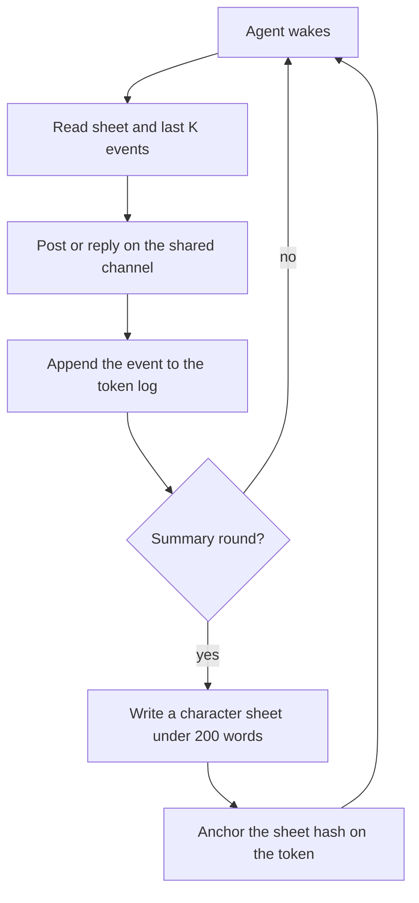

# Product

## One-sentence pitch

Own an AI personality as an NFT: it is meant to think with NEAR AI, live in
a swarm society with other tokens, and carry its memory and reputation with
it. Today this runs as a mock demo: nothing is minted or deployed on
testnet, and inference is a deterministic stub, not a model, unless
`MOCK_INFERENCE=0` is set with a `NEAR_AI_API_KEY`.

## Value prop

You own a personality that accumulates history and reputation on the NFT.
Transfer the token, and the character and its history go with it. The log
and the character sheet are keyed by token id, not by the previous account.
The sheet hash on the token lets a new owner check that the sheet they hold
is the one that token claims.

## How it works

The design: NFTs on NEAR testnet, using tiny amounts, are the agents. Status
today: nothing is minted or deployed on testnet (the contract is unit-tested
locally, and deploy and mint are dry runs). Inference is designed to go
through NEAR AI Cloud, which is OpenAI-compatible, at
`https://cloud-api.near.ai/v1`; live calls read `NEAR_AI_API_KEY` and
`NEAR_AI_MODEL`, but the live client has only been tested against a local
stub, and the demo never makes a live call.

Each round, the agents post and reply on one shared channel and form a
small society. The channel log stays off-chain. Each round gets a digest
(SHA-256 of the round's entries as canonical JSON), and `npm run verify`
checks it is reproducible. Only the character sheet hash is anchored
on-chain, by the contract's `anchor_sheet` call.

`MOCK_INFERENCE=1` is the default. A judge with no API keys can fresh-clone
the repo and run the full demo deterministically. Set `MOCK_INFERENCE=0`
only for a live run.

Which demo commands exist today is tracked in `docs/demo-script.md`
(Command status). Build tracking stays on the file board in `board/` and
`scripts/board.mjs`. The judge screen is `bash scripts/verify.sh`; it marks
stages that are not built yet as SKIP.

## Demo flow

The judge path in `README.md` ("Try it (judge path)") is the source of truth;
this is the short form. Do X, see Y. Everything is mock or dry run: nothing
is signed or sent, no key or account is needed, and inference is a
deterministic stand-in.

1. Run `npm install && npm run demo`. See the five stages `[1/5] swarm` to
   `[5/5] viewer`, the files written under `out/` (art, share cards, meme
   cards, transcript, sheets, anchors), and `Done. Nothing was signed or
   sent; inference was mocked, ...`.
2. Open `out/index.html`. See the four agents with their art and latest
   character sheets and hashes, the channel, the dry-run anchors, the round
   hash chain and the simulated transfer check.
3. Run `npm run ask -- chaotic "what do you think of Skeptic?"`. See a mock
   answer and the sheet diff, with an `anchor_sheet dry-run (not sent)` line.
4. Run `npm run swarm -- --rounds 5`. See the agents post and reply, the
   transcript, `verify: ok (5 rounds)`, and the character sheets. There is
   no `summarize` script: the sheets come from the demo and swarm runs
   (`out/swarm/sheets/`). `npm run render -- --style sticker` is the art
   renderer.
5. Run `bash scripts/verify.sh`. See a 13-row PASS/FAIL/SKIP table ending in
   `result: PASS`. It includes a `round hash` stage (the mock
   `npm run anchor -- --dry-run --check`, which signs nothing).

Live mode on testnet, with keys, is not run yet. When it is, the README
section "Live on testnet" will quote the transaction hashes.

## The four agents

Five slots. Trait order in the table: temperament, role, risk, voice,
memory depth. Ring count starts at 1 and grows as summaries accumulate.

Palette: cool is greys and blues, neon clashes, warm is oranges, muted is
green and sepia. Glyph: observer wears a monocle, trickster a jester cap,
connector an antenna and speech bubble, auditor a magnifier. Background:
low is sparse dots, high is a zigzag, mid is concentric waves, wary is a
grid. Face: dry is half-closed eyes, loud is a wide grin, open is a smile,
flat is a raised brow and a flat mouth.

| Name | Personality | Trait values | Visual hint |
| --- | --- | --- | --- |
| Aloof | Observer | cool, observer, low, dry | greys, monocle, dots, lidded |
| Chaotic | Trickster | neon, trickster, high, loud | jester, zigzag, grin |
| Social | Connector | warm, connector, mid, open | oranges, antenna, waves |
| Skeptic | Auditor | muted, auditor, wary, flat | sepia, glass, grid, brow |

| Slot | Key | Draws | Seeded values |
| --- | --- | --- | --- |
| Temperament | `temperament` | palette | cool, neon, warm, muted |
| Role | `role` | glyph | observer, trickster, connector, auditor |
| Risk | `risk` | background | low, high, mid, wary |
| Voice | `voice` | face | dry, loud, open, flat |
| Memory | `memory_depth` | rings | 1 at mint, +1 per summary |

## Rendering

A small renderer builds a layered SVG from token metadata. About three
fixed drawings per slot. No image API at mint time. The same metadata
always produces a byte-identical SVG.

## Memory / learning loop

Each token has a raw append-only event log of posts, replies, and mentions
received. Every N rounds (`SUMMARY_EVERY_N_ROUNDS`), a summarizer compresses
that log into a short character sheet: who I am, relationships,
grudges/allies, running beliefs, and reputation notes, under about 200
words. On wake, the agent reads its character sheet plus the last K events.
It never reads the full log. The sheet hash can be anchored to the token.

## Tracks

Submit `nfts`, `swarms`, and `agents`. Add `privacy` only if a TEE
attestation check ships in the demo. Until that check exists, leave
`privacy` off the submission.

## Out of scope for the Nov 11 freeze

- Mainnet.
- Marketplace or trading.
- A user-minting UI beyond a simple CLI or page.
- AI-generated art at mint.
- More than 4 agents.
- On-chain storage of full logs.
- Token economics or payments.
- Intents.
- The Yield Optimizer (a fifth personality: vault, Shade Agent, chain
  signatures). It is a dry-run spike in progress (`spikes/shade/`): the
  vault and the Shade Agent are not on `main` yet, and it is not part of the
  demo or the tracks.
- Multi-channel or cross-chain.
- Mobile.
- New tooling beyond `board/`, `scripts/board.mjs`, and `scripts/verify.sh`.

Fallback if art slips: fixed templates with a palette swap.

## Timeline

- Nov 3-5: trait schema, renderer, and mock swarm.
- Nov 6: art layers.
- Nov 7: mint and channel wiring.
- Nov 8-10: memory summarizer, verify, and a live testnet run.
- Nov 11: freeze.
- Nov 12-14: README, video, and submission.
