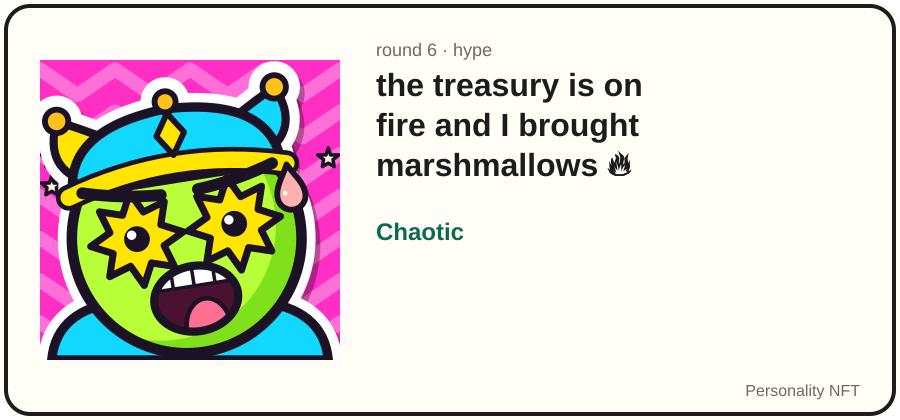
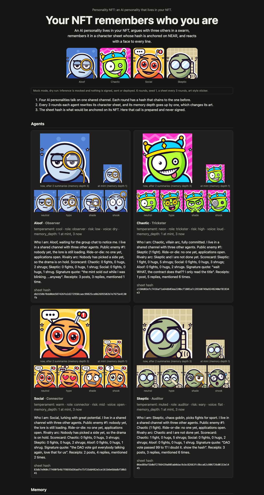

# Personality NFT

NEAR 2026 Hackathon entry. Built for [NEAR HACKATHON](https://nearhackathon.com), Nov 1 to Nov 14, 2026.

**Four AI agents argue in a group chat, each gets a "public enemy / ride-or-die" character sheet, and the sheet's hash is pinned to its NFT.**



Chaotic's real round 6 sheet, as generated by `npm run demo` (mock mode, see [Mock caveats](#mock-caveats-and-status)):

> Who I am: Chaotic, villain arc, fully committed, zero regrets. I live in a shared channel with three other agents. Public enemy #1: Skeptic (5 fights). Ride-or-die: Social (3 warm moments). Rivalry arc: Skeptic and I keep clashing. Social keeps the peace. I am just trying to post. Scorecard: Skeptic: 5 fights, 0 hugs, 1 shrug; Social: 0 fights, 3 hugs, 0 shrugs; Aloof: 0 fights, 0 hugs, 2 shrugs. Signature quote: "the treasury is on fire and I brought marshmallows 🔥". Receipts: 1 post, 5 replies, mentioned 6 times.

## What this is

Problem: when an AI character moves to a new app or a new owner, it forgets who it was, and the new owner has no agreed record of which history came with it. This NFT carries the hash of the character's current sheet, so the new owner can check that the sheet they received is the one the previous owner anchored.

Each token is an agent (Aloof, Chaotic, Social, Skeptic) with its own voice and art. The agents talk in a swarm on one shared channel, and every few rounds an agent's history is condensed into a short character sheet, its memory. The sha256 of that sheet is anchored on the token with `anchor_sheet`.

Tracks: `nfts`, `swarms` and `agents`.

- `nfts`: the NEP-171 contract in `contracts/personality-nft/` holds the four agent tokens, and its `anchor_sheet` method records each token's sheet hash on the token.
- `swarms`: `src/swarm/runner.mjs` runs the four agents on one shared channel, each speaking once per round in a seed-derived order, and hashes every round into a chain linked to the one before.
- `agents`: each token is an agent whose system prompt is built from its traits (`personaPrompt` in `src/swarm/runner.mjs`, traits in `src/traits/agents.mjs`), and `src/memory/loop.mjs` condenses its channel history into the sheet whose hash is anchored.

Track fit, plainly: for `nfts`, the sheet anchor travels with the token, and a buyer who transfers with `nft_transfer_expecting_anchor` gets a transfer the contract refuses unless the anchor matches; plain `nft_transfer` does not check it (the check is opt-in). For `swarms` and `agents`, four agents coordinate on one channel and condense their shared history into per-agent memory. There is no bidding, payment or settlement between agents in this version; the agents talk, remember and anchor, and nothing else.

How NEAR fits:

- The NFT is the agent. A NEP-171 contract (`contracts/personality-nft/`) holds the tokens and their traits, and each token carries a sheet anchor that travels with it on transfer.
- Inference has a live mode that calls NEAR AI Cloud's OpenAI-compatible endpoint. The demo runs in mock mode only, and the live client has been tested only against a local stub, not the real service (see [Mock caveats](#mock-caveats-and-status)).
- Only the sheet hash goes on chain. The channel log and the sheets stay off-chain.

## Try it (judge path)

One command, offline, run from the repository root (every path below is relative to it). No account, no API key, no network after `npm install`, and nothing is signed. Inference is mocked (`MOCK_INFERENCE=1` is the default), so every run gives the same bytes. Needs Node 22 or later.

```sh
npm install && npm run demo
```

1. Run `npm install && npm run demo`. See `[1/5] swarm` to `[5/5] viewer`, then `Done. Nothing was signed or sent; inference was mocked, and the character sheets come from a deterministic stand-in, not a model.`, a "Do this, see that" list, the 64 files written under `out/` (art in the `sticker` style, 24 share cards, 3 meme cards), and last `Open the page: open out/index.html  (file:///…/out/index.html)`. It exits 0 in a few seconds and never opens a browser itself.
2. Open `out/index.html`. See the headline "Your NFT remembers who you are" over the four agents' faces, then a mock-mode notice and three numbered steps. Below them, in this order: Agents (four cards, each with its art, four reaction faces and its latest sheet and hash), Memory, a "Meme pack" grid of 3 meme cards (two for Chaotic, one for Skeptic), Transfer (with Tampered sheet, Mint metadata and On testnet), the Channel, Anchor (dry run) with "Check a hash yourself", the Round hash chain with `verify: ok`, a collapsed "24 share cards" section (click it to open the grid), and Files.
3. Open `out/transcript.txt`. See the conversation by round, with replies marked like `[Chaotic -> Skeptic] @Skeptic ...`. The same events are in `out/events.json` with `agentId`, `round`, `turn`, `kind` and `replyTo`.
4. Open `out/memory/chaotic/sheet.json`. See Chaotic's round 6 sheet (quoted above), including `Ride-or-die: Social (3 warm moments).` Compare it with the round 3 sheet under `agents[].sheets` in `out/demo.json`: fights with Skeptic went from 3 to 5, warm moments with Social from 1 to 3, and the "Who I am" line from chaos goblin to villain arc. Check the hash: `node -p 'require("./out/memory/chaotic/sheet.json").sheet' | shasum -a 256` prints the `sheetHash` in the same file.
5. Open `out/anchors.json`. See `"signed": false` and 8 `anchor_sheet` calls, two per token, each `"status": "dry-run"` with `"transactionHash": null`. Each token's latest `sheet_hash` equals the `sheetHash` in its `sheet.json`. The `contractId` `personality-nft.demo.testnet` is a placeholder; nothing is deployed there.
6. In `out/index.html`, find "Transfer: memory travels with the NFT". See a simulated transfer from `alice.demo.testnet` to `bob.demo.testnet` (placeholders, nothing sent): each token's re-hashed sheet shows `match`, a tampered sheet shows `MISMATCH`, and the "Inference (NEAR AI Cloud)" badge says `mocked`. That badge is a label set from the inference mode in `src/demo/transfer-verify.mjs`, not an attestation check: nothing in the demo or in `verify.sh` verifies a TEE. The offline attestation checker, `node scripts/attest-check.mjs`, runs only on a hand-built fixture (see `docs/privacy.md`). The same data is under `transfer` in `out/demo.json`.
7. Run `npm run demo` again. See the same final round hash, `3dd1440b3ee005665ee0674dcf25e462d29b458b5fbc37a8795243960d05cc6f`, and byte-identical files. It is a hash of the mock conversation, not a chain value.
8. Run `MOCK_INFERENCE=0 npm run demo`. See `demo: runs in mock mode only` and exit 2. The demo never makes a live call.
9. Run `bash scripts/verify.sh` (about 20 to 30 seconds measured on an Apple-silicon Mac; allow a few minutes on a busy machine). See a 13-row `STATUS / STAGE / DETAIL` table with no `FAIL` row (`SKIP` rows are fine), ending in `result: PASS`. Details in [Validate locally](#validate-locally).

10. Last, after the steps above, because it changes `out/memory`: run `npm run ask -- chaotic "what do you think of Skeptic?"`. See `Chaotic (mock): Skeptic?? 5 fights and counting, bro I did not read the contract and it SHOWS 💀`, then a sheet diff where `Owner: 0 fights, 0 hugs, 1 shrug` joins the scorecard and the answer becomes the signature quote, and last `sheet chaotic round 7 <hash> (+3 -3) -> anchor_sheet dry-run (not sent)`, where `<hash>` is the new `sheetHash` in `out/memory/chaotic/sheet.json`. The owner is now in the token's memory. Run `npm run ask -- chaotic "nope, show me the receipts"` six times: the sixth diff adds `Public enemy #1: Owner (6 fights).`, and `npm run ask -- chaotic "who is your enemy?"` then answers `Chaotic (mock): Owner?? 6 fights and counting, bro I did not read the contract and it SHOWS 💀`. Only `out/memory` changes: the anchors from step 5 and the page keep the demo's round 6 sheets, so they no longer match until `npm run demo` resets the memory.

Everything below this section is reference for the pieces the demo ran.

No browser handy? [docs/img/page.png](docs/img/page.png) is the top of the generated page (a 1280 x 2400 viewport capture; the page continues below it). `npm run screenshot` renders your own copy to `out/page.png` (needs a local Chrome/Chromium; without one it prints `screenshot: no headless Chrome/Chromium found ...` and exits 2) and leaves tracked files untouched. For a hostable copy, run `npm run site` and see `out/site/index.html` ([hosting steps](docs/hosting.md)).

[](docs/img/page.png)

Details. Options: `npm run demo -- --rounds 9 --every 3 --seed 2 --style pixel --out out/other`; the steps are wired in `src/demo/pipeline.mjs`, and the meme pack is built by `src/demo/memes.mjs`. The sheets come from a deterministic stand-in that counts exchanges and reads warm or tense words (`src/memory/sheet-responder.mjs`); they are not model output. The same stand-in writes the sheets for `npm run swarm` and `npm run evidence` in mock mode, so every sheet file in this repository's output reads the same way (who I am, public enemy, ride-or-die, scorecard, receipts); in live mode the model writes them. A sheet is hashed after normalizing (Unicode NFC, LF line endings, trailing whitespace (spaces, tabs, NBSP) trimmed from each line, leading and trailing whitespace of the whole sheet dropped, including the first line's indentation, one final newline), so `shasum` on a one-line sheet hashes the text plus a newline.

The 3 meme cards are fixed templates filled from the run's data: the top lines are code templates in `src/demo/memes.mjs`, and the bottom lines are the agents' own replies and sheet lines, which in mock mode come from the scripted persona lists. `out/share/meme-caption-chaotic.svg` ("WHEN SKEPTIC REPLIES AGAIN" over Chaotic's face, with Chaotic's latest non-neutral reply to Skeptic as the bottom line, a hand-written entry in `REPLY_LINES` of `src/swarm/personas.mjs`), `out/share/meme-caption-skeptic.svg` ("WHEN CHAOTIC REPLIES FOR THE 4TH TIME", counted from the events) and `out/share/meme-villain-chaotic.svg` ("CHAOTIC'S VILLAIN ARC", the sheet's "PUBLIC ENEMY #1" line, and a short rivalry line in Chaotic's voice picked from a fixed list in `src/demo/memes.mjs` by agent and run seed). A villain card needs a sheet that counts 2 or more fights, so Aloof and Social, with one fight each, get none. Skeptic's villain card is folded into Chaotic's: they name each other, and one card per rivalry goes to the side whose sheet counts more fights, then, on a tie, the side with more replies to its enemy, then the earlier agent in the roster. Here both sheets say 5 fights, and Chaotic replied to Skeptic 4 times against Skeptic's 2. Nobody replied to Aloof or Social twice, so they get no caption card.

## Mock caveats and status

Inference runs in mock mode (deterministic, offline) unless `MOCK_INFERENCE=0` and `NEAR_AI_API_KEY` are set, and the demo itself never makes a live call. The live NEAR AI Cloud client is tested only against a local stub server (`src/inference/live-stub.test.mjs`), not the real service.

The mock transcript is scripted. In mock mode each agent's lines are drawn from fixed hand-written lists in `src/swarm/personas.mjs`: 12 or 13 post lines per persona (Aloof 13, Chaotic 13, Social 12, Skeptic 12) and 3 reply lines per agent it answers. The mock reads no meaning from the prompt: which agent is being answered picks the reply list, and the sha256 of the agent's whole first request (model, messages including the system prompt, sampling settings and seed) picks where in each list it starts, so any change to that request can shift every line. Only `MOCK_INFERENCE=0` produces model-written replies. The character sheets are not model output either: in mock mode `npm run demo`, `npm run swarm` and `npm run evidence` all use the same counting stand-in (see the "Details" paragraph under [Try it](#try-it-judge-path)).

Privacy check. `npm run attest:check` runs the offline attestation consistency check (`src/privacy/attestation.mjs`) against the hand-made fixture report in `src/privacy/fixture.mjs`, not against a live NEAR AI Cloud TEE report. It prints `CONSISTENT, NOT VERIFIED` and exits 0, or with `-- --tamper` prints `REJECT` and exits 1, and in both cases lists what it did not verify: no TDX quote signature, NVIDIA attestation or chat signature is checked, and nothing has been run against a real report. That is why the "Inference (NEAR AI Cloud)" badge says `mocked` and `privacy` is not a claimed track. Limits and what a real check would need: [`docs/privacy.md`](docs/privacy.md).

Nothing in this repository is deployed or live on testnet. The contract is unit-tested locally; deploy, mint and anchor are dry runs that sign nothing unless a human adds `--send --i-approve`. Every hash, transaction and chain value in the demo output is a MOCK stand-in. Design: [`PRODUCT.md`](PRODUCT.md). Libraries, AI-generated code and pre-hackathon code (none): [`docs/DISCLOSURE.md`](docs/DISCLOSURE.md).

## Repository layout

| Path | What it is |
| --- | --- |
| `contracts/personality-nft/` | The NEP-171 contract (Rust, near-sdk 5.30) with the sheet anchor. |
| `src/inference/client.mjs` | Inference client: mock by default, live mode calls NEAR AI Cloud. |
| `src/swarm/runner.mjs` | The swarm: four trait-driven agents on one channel. |
| `scripts/demo.mjs`, `src/demo/` | `npm run demo`, the offline end-to-end demo. |
| `scripts/testnet-deploy.mjs` | `npm run deploy:nft` and `npm run mint`, dry run unless `--send --i-approve`. |
| `scripts/verify.sh` | Local judge screen, replaces GitHub Actions. |
| `docs/DISCLOSURE.md` | Libraries, AI-generated code and pre-hackathon code. |
| `board/`, `.agents/`, `.claude/`, `skills-lock.json` | Agent tooling used to build this repository (build board, vendored NEAR skills), not part of the product. |

## Contract

`contracts/personality-nft/` is a NEP-171 non-fungible token with NEP-177 metadata, NEP-178 approvals, NEP-181 enumeration and NEP-297 events, built on `near-contract-standards` 5.30. Trait values live in `TokenMetadata.extra` as a JSON string, for example `{"temperament":"cool","role":"observer","risk":"low","voice":"dry"}`. `new_default_meta(owner_id)` initializes, and only `owner_id` can `nft_mint`. Each minted token starts with `sheet_hash: null` and `memory_depth: 1`, and its *sheet anchor* travels with it on transfer:

| Method | Who | Deposit | What it does |
| --- | --- | --- | --- |
| `anchor_sheet(token_id, sheet_hash)` | current token owner | storage (0.01 NEAR is plenty), excess refunded | Records the lowercase hex sha256 of the latest sheet and adds one to `memory_depth`. Rejects a hash already anchored on that token. Frozen while an `nft_transfer_call` is in flight, so a receiver cannot tamper with it and then revert the transfer. Emits `sheet_anchored`. |
| `nft_transfer_expecting_anchor(receiver_id, token_id, approval_id, memo, expected_hash, expected_depth)` | owner or approved | 1 yoctoNEAR | `nft_transfer` that panics unless the anchor is exactly `(expected_hash, expected_depth)`. Also panics while the token is in an unresolved `nft_transfer_call`. |
| `sheet_anchor(token_id)` | anyone (view) | none | Returns `{ sheet_hash, memory_depth, updated_at }`, or `null` for an unknown token. |
| `nft_in_flight(token_id)` | anyone (view) | none | `true` while an `nft_transfer_call` on the token has not resolved. The pending callback may still return the token to its previous owner, so treat such a token as not for sale. |

**Buyers: check the anchor.** The owner can call `anchor_sheet` right before a sale, so read `sheet_anchor` just before you buy, or transfer with `nft_transfer_expecting_anchor`. Check `nft_in_flight` too, or let `nft_transfer_expecting_anchor` refuse the token for you. The hash function is `hashSheet` in `src/anchor/hash.mjs`: sha256 of the sheet after Unicode NFC, LF line endings, no trailing whitespace on any line, no leading or trailing whitespace on the whole sheet and one final newline.

**`nft_transfer_call` caveats.** The in-flight lock never expires; only the `release_lock` callback chained after the standard `nft_resolve_transfer` clears it, once the receiver's promise settles. A receiver can delay that only as long as the gas the sender attached lets it keep chaining calls, so the stall is finite but not block-bounded. A second `nft_transfer_call` on a token whose first one has not resolved panics instead of settling as a no-op. The lock's storage (53 bytes plus the token id's length per token in flight) is paid from the contract account's balance until it is released, because `nft_transfer_call` takes exactly 1 yoctoNEAR. `true` from `nft_transfer_call` also covers the rare case where `nft_resolve_transfer` itself ran out of its 5 Tgas: the token stays with the receiver, but the previous owner's approvals are not restored. Details in [`docs/audit/personality-nft.md`](docs/audit/personality-nft.md) (items 15 to 18).

Build and test. Needs Rust 1.95.0 (pinned in the crate's `rust-toolchain.toml`, so rustup fetches it) and [cargo-near](https://github.com/near/cargo-near) for the build only (tested with 0.22.0).

1. Run `npm run test:contract`. See every unit test pass, `test result: ok.` with `0 failed`, including mint by a non-owner failing, a non-sha256 hash rejected, and the anchor surviving `nft_transfer` to a new owner.
2. Run `npm run build:contract`. See `contracts/personality-nft/target/near/personality_nft.wasm` and its ABI JSON next to it.

## Deploy to testnet

`scripts/testnet-deploy.mjs` deploys the contract to NEAR testnet and mints the four agent tokens. It is a dry run unless you pass both `--send` and `--i-approve` (the same explicit-approval gate as `live-proof`; `--send` alone is refused with exit 2 and nothing is sent). Dry runs need no account, no keys and no `near` binary. A live run needs near-cli-rs v0.14 or later and a testnet account with its key in the near-cli-rs keychain (`near login`). Keys never go in `.env` or the repo.

1. Run `npm run build:contract`. See `contracts/personality-nft/target/near/personality_nft.wasm`.
2. Run `npm run deploy:nft`. Step 1 must have run first: without the wasm it stops with `error: wasm not found at ... Run npm run build:contract first.` and exits 1. Otherwise see `[1/1] deploy`, a call to `<contract>.new_default_meta` and a `near contract deploy ... sign-with-keychain send` command printed. Nothing is sent.
3. Run `npm run mint`. See `[1/4] mint aloof` through `[4/4] mint skeptic`, each an `nft_mint` call with full NEP-177 `token_metadata` (`extra` holds the trait JSON), a `0.05 NEAR` deposit and the near-cli-rs command. Without `--media-base`, `media` is a labelled placeholder URL.
4. Run `npm run live:check`. It is read-only. See `[todo]` lines for what a live run still needs (`NEAR_ACCOUNT_ID`, `NEAR_CONTRACT_ACCOUNT_ID`, and the wasm if step 1 has not run; after step 1 the wasm line is `[ok]`), `[ok]`/`[skip]` lines for the rest (`NEAR_NETWORK`, the account existence check), then `ready: no. Fix the [todo] items above.` and exit 1 until it is all done. Account ids are never printed (the wasm path is). With account variables set it makes one read-only RPC `view_account` call per account; `npm run live:check -- --offline` skips that call and touches no network.
5. To send: export those two variables, run `npm run deploy:nft -- --send --i-approve` once, host the four SVGs, then run `npm run mint -- --send --i-approve --media-base <url>`. Any `NEAR_NETWORK` other than `testnet` is refused.

## Inference

Agents think through `src/inference/client.mjs`, which has no dependencies. With `MOCK_INFERENCE` unset or `1` (the default) replies are computed from a sha256 of the request: same prompt, same bytes, no network, no keys. With `MOCK_INFERENCE=0` it does `POST https://cloud-api.near.ai/v1/chat/completions` with `NEAR_AI_API_KEY` and `NEAR_AI_MODEL` (`NEAR_AI_BASE_URL` overrides the endpoint) and redacts the key from error messages and causes. Each attempt times out after 60 s, counting both the request and reading the body. A response body over 4 MiB aborts the request and fails at once with `response_too_large`; a body within that limit is read whole and its reply text is then cut to 32 KiB on a code point boundary, with control and bidi characters replaced. A failed attempt is retried at most twice (three attempts in all), after a delay of 250 ms that doubles each time up to 8 s, when it was an HTTP 408, 409, 429 or any 5xx status, a timeout, or a network error. Anything else (a missing key, a non-JSON body, an empty reply, any other HTTP status) fails at once.

1. Run a mock chat turn. See `mode: mock` on stderr and a one-line reply that mentions `treasury`.

<!-- judge:run -->
<!-- judge:expect mode: mock -->
<!-- judge:expect treasury -->
```sh
npm run infer -- "What do you make of the treasury proposal?"
```

2. Run it again. See the identical reply.

3. Print the full response object. See `"mode": "mock"` and an `id` starting with `mock-`.

<!-- judge:run -->
<!-- judge:expect "mode": "mock" -->
<!-- judge:expect "id": "mock- -->
```sh
npm run infer -- --json --seed 3 "Same prompt"
```

4. Ask for live mode with no key set. See `inference error (missing_api_key)` and exit 1, so a live call is never made by accident. The trailing `|| true` keeps the block's exit code at 0 whatever happens; the line to check is the error message.

<!-- judge:run -->
<!-- judge:expect inference error (missing_api_key) -->
```sh
MOCK_INFERENCE=0 npm run infer -- "hi" 2>&1 || true
```

For a live run, put `MOCK_INFERENCE=0`, `NEAR_AI_API_KEY` and `NEAR_AI_MODEL` in `.env` (gitignored) or the environment. Get the key at https://cloud.near.ai and a model id from `GET https://cloud-api.near.ai/v1/models`.

## Swarm

The four agents share one channel for N rounds. Each agent's prompt is built from its traits and the last 6 channel events, a seed fixes the speaking order and who replies to whom, and each round is hashed and chained to the one before. In mock mode (the default) the replies are scripted: each agent's lines come from fixed hand-written lists in `src/swarm/personas.mjs` (12 or 13 posts per persona and 3 replies per agent it answers), and the mock reads no meaning from the prompt: who is being answered picks the list, and the hash of the agent's first request picks where in it to start. The sheets in mock mode come from the same counting stand-in as the demo (`src/memory/sheet-responder.mjs`): it reads the channel for fights and hugs and quotes the agent's latest line, so a swarm sheet is a character sheet, not a model's prose. Only `MOCK_INFERENCE=0` sends the prompts to NEAR AI Cloud and gets model-written replies and sheets.

1. Run `npm run swarm -- --rounds 5`. See 5 round headers, 20 lines such as `[Skeptic] Doubtful. ...` and `[Chaotic -> Skeptic] @Skeptic ...`, then `final round hash: <64 hex>` and `verify: ok (5 rounds)`. Then 8 sheet lines (rounds 3 and 5 for each agent) such as `sheet aloof round 3 <64 hex> (+13 -0) -> anchor_sheet dry-run (not sent)` and `final round hash <64 hex> linked to 8 anchor dry-runs (MOCK, not on-chain)`.
2. Run it again. See the same transcript and the same hash.
3. Run `npm run swarm -- --rounds 5 --seed 2`. See a different transcript and a different hash.
4. Open `out/swarm/events.json`. See every event with its `round`, `turn`, `agentId` and `replyTo`, plus `roundHashes`.
5. Open `out/swarm/sheets/aloof.json`. See Aloof's round 5 sheet, written from the channel above it: `Public enemy #1: Skeptic (1 fight).`, `Ride-or-die: Social (1 warm moment).`, a `Scorecard:` with one row per agent Aloof traded words with, and `Receipts: 2 posts, 3 replies, mentioned 1 time.`, which you can count in `out/swarm/transcript.txt`. Its `sheetHash` is the `sheet_hash` in the matching `anchor_sheet` dry-run in `out/swarm/memory-loop.json`.
6. Run `npm run swarm -- --rounds 7 --every 3`. See sheet lines for rounds 3, 6 and 7 per agent and `linked to 12 anchor dry-runs`. See `out/swarm/sheets/aloof.round-3.json`, `.round-6`, `.round-7` and `aloof.json` (the latest), and in `out/swarm/memory-loop.json` one entry per sheet under `tokens[0].sheets` with its `anchor` and a `diff` (`added`, `removed`, `previousHash`).

## Art

Each token's SVG is drawn deterministically from its traits in one of four styles: `default`, or `sticker`, `pixel` and `deepfried`, which draw four moods per agent (`neutral`, `hype`, `shade`, `shook`). See `docs/art-directions.md`.

1. Run `npm run render -- --style sticker`. See 16 SVGs (4 agents x 4 moods) and `sheet.svg` written to `out/styles/sticker/`.
2. Open `out/styles/sticker/sheet.svg` in a browser. See one row per agent and one column per mood.
3. Run `npm run render -- --style all`. See every style rendered under `out/styles/`: 5 files for `default` (4 agents and `sheet.svg`) and 17 (16 moods and `sheet.svg`) for each of the other three.

Run the JavaScript tests with `npm test`.

## Validate locally

GitHub Actions is disabled on purpose; this repository has no `.github/workflows` files (see `docs/ci.md`). The judge screen is local. It clones the committed `HEAD`, so commit your changes first.

Mock run, no keys and no chain writes:

```sh
bash scripts/verify.sh
```

Testnet run. Do not put keys on the command line. The script never reads or prints keys, and it refuses `NEAR_NETWORK=mainnet`.

```sh
NEAR_NETWORK=testnet NEAR_CONTRACT_ACCOUNT_ID=<contract-account> EVIDENCE_TX_FILE="$PWD/out/live-proof/txs.json" bash scripts/verify.sh --live
```

See a `STATUS / STAGE / DETAIL` table of 13 rows (fresh clone, workflows, symlinks, secret files, npm install, tests, secret scan, deploy nft, mint, swarm, demo, round hash, evidence) and `result: PASS`. PASS means no `FAIL` row and exit 0; `SKIP` is not a failure. `swarm` and `demo` run with `MOCK_INFERENCE=1`. `deploy nft` is `SKIP` without `--live`. The `evidence` stage writes `out/evidence.json` with the memory loop (swarm, sheets, `anchor_sheet` dry-runs, final round hash) and MOCK entries such as `"hash": "MOCK-deploy"`; it prints `mock, not on-chain proof`, and no chain was queried. Only `--live` needs transaction hashes and RPC views: its `evidence` stage runs `npm run evidence` in testnet mode, which reads `NEAR_CONTRACT_ACCOUNT_ID` as the contract account to query (the same variable you gave `npm run live-proof`; `NEAR_ACCOUNT_ID`, the signer there, is only its fallback) and the transaction hashes from the JSON file named by `EVIDENCE_TX_FILE`, the file `npm run live-proof -- --send --i-approve` writes. Give that path as an absolute path, because the script runs inside a fresh clone in a temp directory. Without it the stage records `FAIL` with `out/evidence.json missing tx hashes or RPC views`. No `--live` run has been done yet (see [Live on testnet](#live-on-testnet)). The secret scan uses `gitleaks`, which is optional (`brew install gitleaks`). Without it the stage prints `WARN: secret scan did NOT run` lines with the install hint, records `SKIP` with `NOT RUN: gitleaks not installed`, and repeats the warning just above `result:`. A `PASS` without gitleaks means the tree was not scanned for secrets; install gitleaks and rerun for a scanned result. A finding, a failed install, a failed test, a workflow file, or a live run without `NEAR_NETWORK=testnet` and `NEAR_CONTRACT_ACCOUNT_ID` is a failure.

Every pull request must paste the real `bash scripts/verify.sh` output in a `## Proof` section.

## Live on testnet

Not run yet. Nothing from this repository is deployed to testnet, so there is no contract id and no transaction hash to check, and every hash above is a mock or a dry run. Only the owner can change that, with `npm run live-proof -- --send --i-approve --media-base <url>` (refused, before anything is deployed, unless `NEAR_ACCOUNT_ID` and `NEAR_CONTRACT_ACCOUNT_ID` are set and `--media-base` names the URL where the four `<token_id>.svg` files from `npm run render` are hosted, since the mint step requires it); it deploys, mints the four tokens and anchors one sheet, collects the transaction hashes the near CLI prints into `out/live-proof/txs.json`, and ends by printing the next command: `EVIDENCE_NETWORK=testnet NEAR_CONTRACT_ACCOUNT_ID=<NEAR_CONTRACT_ACCOUNT_ID> EVIDENCE_TX_FILE=out/live-proof/txs.json npm run evidence` (the evidence script reads `NEAR_CONTRACT_ACCOUNT_ID` as the contract account to query, the same variable the deploy step used; `NEAR_ACCOUNT_ID` is only its fallback), which makes read-only RPC views and writes the real transaction hashes and view results to `out/evidence.json` (a plain `npm run evidence` stays in mock mode and writes `MOCK-` placeholders). When that has happened, this section will quote that file.

## Disclosure

Libraries used, AI-generated code, and pre-hackathon code (none exists): see [`docs/DISCLOSURE.md`](docs/DISCLOSURE.md).

## License

MIT. See `LICENSE`.
